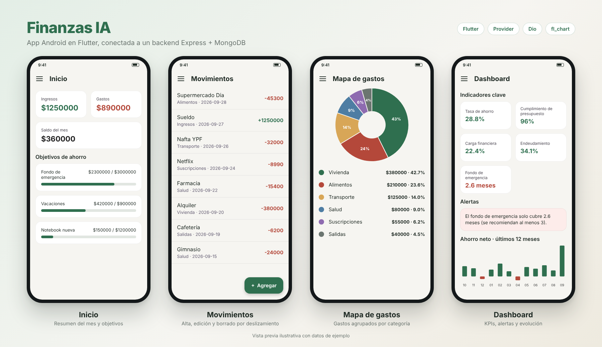
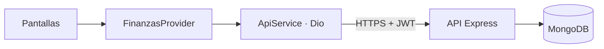

# Finanzas IA · App Android (Flutter)

App móvil de finanzas personales para Android. Es el cliente Flutter de un backend propio en **Node/Express + MongoDB**: consume la misma API REST que usa la versión web, así que los datos son los mismos en ambos lados.



> Vista previa ilustrativa con datos de ejemplo.

## Funcionalidades

| Sección | Qué hace |
|---|---|
| **Login y registro** | Autenticación con JWT. El token se guarda cifrado con `flutter_secure_storage`. Si vence (401), la app vuelve sola al login. |
| **Inicio** | Ingresos, gastos y saldo del último mes con datos, más el progreso de los objetivos de ahorro. |
| **Movimientos** | Alta, edición y borrado (deslizando con confirmación). El formulario usa un selector Gasto/Ingreso que define el signo del importe. |
| **Cuentas** | CRUD completo. El saldo actual se calcula como saldo inicial más la suma de los movimientos de cada cuenta. |
| **Objetivos** | CRUD de metas de ahorro con barra de progreso. |
| **Mapa de gastos** | Gráfico de torta y detalle de gastos por categoría, de mayor a menor. |
| **Patrimonio** | Activos, inversiones, pasivos y créditos, con totales y patrimonio neto (solo lectura). |
| **Dashboard** | 5 indicadores (tasa de ahorro, cumplimiento de presupuesto, carga financiera, endeudamiento y fondo de emergencia), alertas y gráficos de ahorro neto y patrimonio neto de los últimos 12 meses. |
| **Simulador** | Proyecta el saldo del mes reduciendo gastos, aumentando ingresos o sumando un ahorro fijo, sin tocar los datos reales. |

Los datos se recargan desde la API con *pull-to-refresh* (en las pantallas con scroll).

## Stack

- [Flutter](https://flutter.dev) (Material 3) y Dart
- [`provider`](https://pub.dev/packages/provider) para el estado
- [`dio`](https://pub.dev/packages/dio) para HTTP, con un interceptor que agrega el `Bearer` token
- [`flutter_secure_storage`](https://pub.dev/packages/flutter_secure_storage) para guardar el token
- [`fl_chart`](https://pub.dev/packages/fl_chart) para los gráficos

## Cómo funciona



La app **nunca se conecta a MongoDB directamente**: todo pasa por la API.

Varios datos no vienen del backend sino que se **calculan en el cliente** a partir de los movimientos, igual que en la web: los saldos de las cuentas, el resumen del mes, los gastos por categoría, los KPIs y las alertas. No existe un endpoint de "categorías" ni de "reportes". Esa lógica está en `lib/providers/finanzas_provider.dart`.

### Endpoints que consume

| Recurso | Rutas |
|---|---|
| Auth (públicas) | `POST /api/auth/login` · `POST /api/auth/registro` |
| Movimientos | `GET` · `POST` · `PUT /:id` · `DELETE /:id` en `/api/movimientos` |
| Cuentas | `GET` · `POST` · `PUT /:id` · `DELETE /:id` en `/api/cuentas` |
| Objetivos | `GET` · `POST` · `PUT /:id` · `DELETE /:id` en `/api/objetivos` |
| Patrimonio | `GET /api/patrimonio` · `GET /api/patrimonio/evolucion` · `GET /api/patrimonio/evolucion-ahorro` |

Todas las rutas fuera de `/api/auth` requieren el header `Authorization: Bearer <token>`.

## Puesta en marcha

### Requisitos

- Flutter SDK en canal stable (recomendado 3.27 o superior)
- Android Studio con un emulador, o un dispositivo Android con depuración USB

### Instalación

```bash
git clone <url-de-este-repo>
cd finanzas_ia
flutter pub get
flutter run
```

Si partís de un proyecto nuevo, creá la base con `flutter create finanzas_ia`, copiá `lib/` y `pubspec.yaml` de este repo encima, y corré `flutter pub get`.

### Apuntar a tu propio backend

La URL de la API está en `lib/services/api_service.dart`:

```dart
static const String baseUrl = 'https://app-finanzas-gbia.onrender.com/api';
```

Cambiala por la de tu servidor. Si el backend está en un plan gratuito de Render, la primera petición después de un rato sin uso puede tardar en responder mientras el servicio se despierta.

## Generar el APK

```bash
flutter build apk --release
```

El archivo queda en `build/app/outputs/flutter-apk/app-release.apk`. Para subir a Play Store, usá `flutter build appbundle`.

### Permiso de Internet (importante para el build release)

Flutter agrega el permiso de Internet automáticamente solo en los builds de **debug**, por eso `flutter run` funciona sin tocar nada. En el APK de **release** hay que declararlo a mano. En `android/app/src/main/AndroidManifest.xml`, antes de la etiqueta `<application>`:

```xml
<uses-permission android:name="android.permission.INTERNET"/>
```

Sin esa línea, el APK de release se instala pero no puede conectarse a la API.

## Estructura del proyecto

```
lib/
├── main.dart                     # Punto de entrada: decide login u home
├── theme/
│   └── app_theme.dart            # Paleta y estilos (mismo verde que la web)
├── models/                       # Movimiento, Cuenta, Objetivo, Patrimonio
├── services/
│   └── api_service.dart          # Toda la comunicación con el backend
├── providers/
│   └── finanzas_provider.dart    # Estado global y cálculos
└── screens/
    ├── login_screen.dart
    ├── home_screen.dart          # Navegación lateral (Drawer)
    ├── inicio_screen.dart
    ├── movimientos_screen.dart
    ├── formulario_movimiento.dart
    ├── cuentas_screen.dart
    ├── formulario_cuenta.dart
    ├── objetivos_screen.dart
    ├── formulario_objetivo.dart
    ├── gastos_screen.dart
    ├── patrimonio_screen.dart
    ├── dashboard_screen.dart
    └── simulador_screen.dart
```

## Limitaciones conocidas

- Los montos se muestran sin separador de miles (por ejemplo `$1250000`). Se puede mejorar con el paquete `intl`.
- El patrimonio es de solo lectura: la API no expone altas ni ediciones para ese recurso.
- No hay modo sin conexión ni tests automatizados.
- Solo se probó en Android.
